  <picture>
    <source media="(prefers-color-scheme: dark)" srcset="assets/banner-dark.svg">
    
  </picture>

  <a href="https://www.yuanhe.wiki/">Homepage</a> ·
  <a href="https://scholar.google.com/citations?user=sCXUhQcAAAAJ">Scholar</a> ·
  <a href="https://x.com/lawhy_X">X</a> ·
  <a href="https://www.linkedin.com/in/lawhy/">LinkedIn</a>

 

<b>OPEN-SOURCE CONTRIBUTIONS</b>

<table align="center">
  <tr>
    <td align="center" width="140">
      <a href="https://github.com/agentvfs"> <b>AgentVFS</b></a>
    </td>
    <td align="center" width="140">
      <a href="https://github.com/open-rollout"> <b>Open Rollout</b></a>
    </td>
    <td align="center" width="140">
      <a href="https://github.com/camel-ai"> <b>CAMEL-AI</b></a>
    </td>
    <td align="center" width="140">
      <a href="https://github.com/KRR-Oxford"> <b>KRR-Oxford</b></a>
    </td>
  </tr>
</table>
